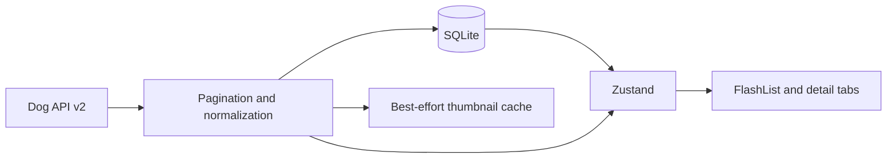

# Tripare AI — Dog Breed Explorer

An Expo + React Native + strict TypeScript app for browsing Dog API v2 breeds, with a SQLite catalog cache, Zustand state, and a FlashList UI.

## Quick Start

```bash
npm install
cp .env.example .env
npm run ios # or npm run android
```

Use a compatible Expo Go client or development build on a device/simulator. expo-system-ui is included so automatic appearance is applied on Android; rebuild an existing development/native build after adding it. The only environment variable is `EXPO_PUBLIC_API_BASE_URL`; it defaults to Dog API v2. A network connection is required for the initial catalog download.

## Architecture Overview

Startup hydrates validated records from SQLite before synchronization begins. Cached breed details, search, and filters work without a network connection. NetInfo triggers synchronization when connectivity returns; pull-to-refresh requests another sync. Page 1 supplies the pagination count, then remaining 48-record pages are fetched with concurrency two. Requests have a ten-second timeout, exponential backoff with jitter, and no retry for permanent client errors.

Valid pages merge into the cache even if other pages or the groups endpoint fail. Cached group labels are retained when groups fail. Missing values remain null and display as Unknown/N/A. A partial-sync warning survives restarts. Thumbnail downloads run separately after catalog data is saved; offline images are best effort and may be unavailable until downloaded or after native cache eviction.



## Key Technical Decisions

- **Zustand:** normalized breed lookup plus ID list; filtering is memoized by the list screen. List/App subscriptions currently read the whole store.
- **SQLite:** WAL, parameterized statements, a shared initialization promise, and serialized write transactions. Groups, breeds, and sync metadata are persisted together for catalog sync.
- **Freshness:** Last synced refers only to the most recent complete catalog sync, including groups. Partial attempts retain that timestamp; detail refreshes never change it. The banner updates every minute.
- **Coat filtering:** type and length are separate. A wire/short breed matches either selected value.
- **Images:** prefetch actual thumbnail variants in batches of four; upgrade visible/adjacent gallery images on demand, falling back large → medium → thumb. No portable hard cache-size cap is claimed.
- **Source quality:** some API gallery photos may be unrelated to the breed. These are retained as supplied, with author/license/source attribution and tappable license links.

See [architecture and schema](docs/ARCHITECTURE.md) and [decisions](docs/DECISIONS.md). Upgrading from the old cache requires a new catalog download: its inferred defaults cannot be recovered reliably. The original table is retained as `breeds_legacy` but is not displayed.

## Performance Report

| Metric | Measurement |
| --- | --- |
| Cached startup to interactive |  |
| Scroll FPS | 60-90 |
| Peak memory |  |
| Main bundle size and breakdown |  |

Profiler screenshots, memory screenshots, and app screenshots have not been captured. See [profiling checklist](docs/PERFORMANCE.md).