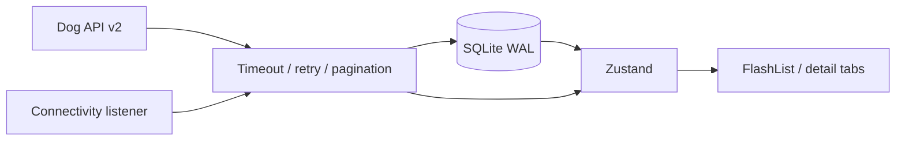

# System Architecture

The app hydrates SQLite before network sync. API responses are normalized into nullable domain fields and stored in Zustand as `breedsById` and `breedIds`. Cached payloads are structurally validated before entering the store.

## SQLite schema

Database: `dog_explorer_v2.db`. Schema version: `PRAGMA user_version = 1`.

| Table | Columns and purpose |
| --- | --- |
| breed_groups | id primary key, name; persistent group labels |
| breeds | id primary key, name, nullable group_name/size_bucket/coat_length/hypoallergenic, JSON payload, updated_at |
| sync_meta | key/value pairs: last_synced_at and last_sync_partial |

Indexes cover breed group name and breed name. The full JSON payload includes both coat type and coat length, traits, ranges, origin, and image attribution. Unknown values are null, including the denormalized nullable columns. Hypoallergenic is stored as 1, 0, or NULL.

One shared initialization promise completes schema setup before callers receive the database. Initialization failures close the connection and allow retry. All application writes use one queue; catalog records, groups, and freshness metadata commit in one transaction. A failed transaction does not poison later queued writes.

Legacy payloads contain inferred defaults with no record of whether the original field was missing. On upgrade, the old breeds table is retained as breeds_legacy and a new active table is populated from the API. Cached groups remain. Old freshness metadata is cleared because its timestamps included detail refreshes. A fresh network download is required after this one-time migration.

## Sync and freshness

Page 1 determines the last page through meta.pagination.last. Remaining pages use page size 48 and concurrency two. Failed or malformed pages mark the attempt partial; valid pages merge with cached records. Unknown pagination completeness also marks the attempt partial. Failed groups retain cached labels and mark the catalog attempt incomplete.

last_synced_at records the local completion time of the last complete catalog sync, including groups. It does not claim that the upstream data was authored at that time. Partial or failed attempts leave it unchanged and persist last_sync_partial = 1. A complete sync clears that flag. A detail refresh updates only its record and updated_at. The UI recalculates relative freshness every minute.

Image prefetch runs outside the database transaction and does not affect catalog freshness. Prefetch completion and offline image availability are not guaranteed. Performance: TODO: measure on device.